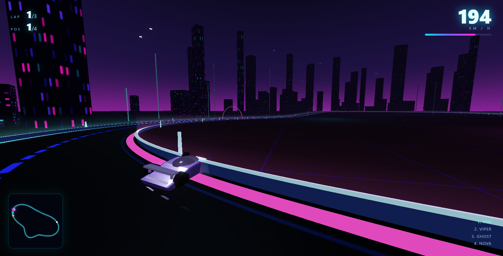

# NEON DRIFT · 霓虹竞速

> 单文件、零构建、开箱即跑的 3D 霓虹赛博朋克赛车小游戏 —— 玩家 1 车 vs 3 个 AI 对手，封闭赛道跑满 3 圈决出名次。



---

## 快速开始

**唯一要求：能打开浏览器 + 能联网（加载 Three.js CDN）。**

1. 双击 `neon-drift-racer.html`（或拖进 Chrome / Edge / Firefox）；
2. 点击「开始游戏」；
3. 3-2-1 倒计时结束后开跑。

无需 Node、无需 npm install、无需本地服务器 —— 文件用 `file://` 协议直接打开即可。

> 如果你的浏览器对本地文件的脚本策略较严格，也可以在目录下执行 `python -m http.server` 后用 `http://localhost:8000/neon-drift-racer.html` 访问。

---

## 操作方式

| 按键 | 功能 |
| :--- | :--- |
| `W` / `↑` | 加速 |
| `S` / `↓` | 刹车；静止时继续按则倒车 |
| `A` `D` / `←` `→` | 左 / 右转向 |
| `空格` | 手刹漂移（抓地力骤降、转向更灵敏，用来过急弯） |
| `R` | 复位到当前赛道位置（卡住时用，保留已完成的圈数） |
| `P` / `Esc` | 暂停 / 继续 |
| `Enter` | 在开始界面或结算界面直接开局 |

**驾驶技巧**：入弯前收油、轻点刹车，弯心稳住方向，出弯再全油门。高速时侧向抓地力会明显下降，硬打方向只会推头撞墙 —— 这就是需要手刹和提前减速的原因。

---

## 游戏规则

- 赛道全长约 **1402 米**，封闭环线，最小曲率半径约 **46 米**；
- 共 **3 圈**，跑完即结束并弹出结算；
- 4 辆车同场：玩家（紫色）+ 3 个 AI（品红 / 青色 / 黄色）；
- 名次按「累计里程 → 冲线时间」实时排序，HUD 右上角是实时名次榜；
- 结算显示最终名次、总用时、最快单圈、最高速度，可一键重开。

---

## 特性一览

### 场景与赛道
- **数学曲线赛道**：极坐标闭合曲线 `r(θ)=R0+Σamp·sin(freq·θ+phase)` 生成，天然闭合、曲率连续、永不穿模；按等弧长重采样为约 876 个采样点（间距 1.6 米），每点缓存坐标 / 切线 / 右向量 / 曲率半径。
- **统一条带生成器**：路面、霓虹边线、护栏、能量光墙全部由同一个 `ribbonGeometry()` 沿赛道挤出，改一个参数就能整体变宽变窄。
- **三层发光**：`emissive` 自发光材质 + 加色混合的渐变光墙（底部亮、顶部透明，带呼吸动画）+ UnrealBloom 泛光。
- **氛围**：自定义着色器天空（地平线辉光 + 星星）、`FogExp2` 指数雾、程序化生成的赛博城市天际线（InstancedMesh，一次绘制上百栋楼）。
- **赛道装饰**：起跑线黑白格、带 5 颗起跑灯的门架、6 道霓虹拱门、两侧发光路桩。

### 赛车
- 车身用 `ExtrudeGeometry` 从侧面轮廓挤出，配座舱、前后灯条、尾翼、底盘霓虹条、带发光轮毂的车轮、车底光晕 Sprite。
- **街机式物理**：纵向（油门 / 刹车 / 二次风阻 / 滚阻）+ 横向速度按 `exp(-grip·dt)` 衰减，速度越快抓地力越低，再叠加转向产生的侧向冲量 —— 于是自然出现甩尾与漂移。
- **物理固定 1/120 秒步长**累加，不同刷新率下手感一致，不会出现 144Hz 比 60Hz 跑得快。
- 尾部双光带拖尾（`Trail`，加色混合 + 逐段衰减），速度越快、漂移时越亮。
- 护栏碰撞沿赛道法线反弹并损失速度，撞击会触发镜头抖动。

### AI
- **纯几何跟随**，无预录路线：按速度预瞄 8~50 米外的赛道点 → 计算「切内弯」横向偏移 → 检测前方 15 米内车辆做横向避让并收油 → 用前方最小曲率半径反推安全过弯速度。
- **三种性格**（只调参数，不写死路线）：

  | 车手 | 颜色 | 性格 | 极速 | 走线偏移 | 手刹倾向 |
  | :--- | :--- | :--- | ---: | ---: | :--- |
  | VIPER | 品红 `#ff2bd6` | 激进 | 69.5 m/s | 切内弯最狠 | 高 |
  | GHOST | 青色 `#00e5ff` | 稳健 | 66.0 m/s | 靠外侧走线 | 低 |
  | NOVA | 黄色 `#ffc93c` | 均衡 | 63.0 m/s | 贴中线 | 中 |

- 车辆之间做圆形分离 + 速度交换，避免穿模，撞车有顿挫感。
- 极小的橡皮筋系数（`clamp(1 + gap·0.0009, 0.95, 1.06)`），让比赛不至于过早失去悬念，又不会明显“作弊”。

### 表现层
- 第三人称跟随镜头：位置与朝向都做指数阻尼（`damp`），转弯时镜头略微滞后，能看到车身侧面。
- 镜头随速度拉远、抬高，FOV 从 62° 平滑推到 78°，速度感更强。
- HUD：圈数、名次、速度数字 + 渐变速度条、小地图（Canvas 2D 绘制赛道轮廓与 4 个车辆光点）、实时名次榜、逆行提示。

---

## 代码结构

整个游戏是一个 IIFE，按 15 个编号模块组织，每段开头有注释分隔线：

| 模块 | 位置（约） | 内容 |
| :--- | :--- | :--- |
| 0. 工具函数 | `neon-drift-racer.html:210` | `clamp` / `lerp` / `damp` / `wrapAngle` / `formatTime` |
| 1. 全局配置 | `neon-drift-racer.html:227` | `CFG`（赛道 / 车辆 / 镜头参数）、`GAME`（运行时状态） |
| 2. 赛道数据模型 | `neon-drift-racer.html:263` | `Track` 类：`build / pointAt / tangentAt / rightAt / nearest / minRadiusAhead` |
| 3. 程序化贴图 | `neon-drift-racer.html:403` | 路面、格纹、光墙渐变、光晕、窗户、地面网格（全部 Canvas 生成，无外部图片） |
| 4. 场景搭建 | `neon-drift-racer.html:512` | `buildSky` / `buildGround` / `buildCity` / `ribbonGeometry` / `buildTrackMeshes` |
| 5. 车辆模型 | `neon-drift-racer.html:836` | `buildCarBodyGeometry` / `createCarMesh` / `Trail` |
| 6. 车辆物理 | `neon-drift-racer.html:1012` | `Car` 类：`placeAt / updatePhysics / updateTrackCoords / collideTrack` |
| 7. AI | `neon-drift-racer.html:1204` | `AI_PROFILES`、`bendAt`、`updateAI` |
| 8. 比赛逻辑 | `neon-drift-racer.html:1281` | `resetRace / computeStandings / startCountdown / finishRace` |
| 9. 摄像机 | `neon-drift-racer.html:1365` | 跟随镜头与菜单环绕镜头 |
| 10. 玩家输入 | `neon-drift-racer.html:1424` | 键盘 → 油门 / 刹车 / 转向 / 手刹 |
| 11. UI | `neon-drift-racer.html:1440` | `cacheUI / updateHUD / buildMinimap / drawMinimap / showResult` |
| 12. 主循环 | `neon-drift-racer.html:1588` | `stepPhysics / separateCars / updateRace / animate` |
| 13. 初始化 | `neon-drift-racer.html:1730` | 渲染器、后处理、灯光、车辆、`init()` |
| 14. 事件绑定 | `neon-drift-racer.html:1843` | 键鼠、窗口尺寸、暂停、复位、开局 |

**依赖**：Three.js r147（经典脚本版，全局 `THREE`）及其 `EffectComposer` / `RenderPass` / `ShaderPass` / `UnrealBloomPass` / `CopyShader` / `LuminosityHighPassShader`，全部来自 jsDelivr CDN。除此之外**没有任何第三方库**。

---

## 调参指南

所有可调参数集中在文件顶部的 `CFG` 与 `AI_PROFILES`，改完刷新页面即可生效。

### 车辆手感

```js
var CFG = {
  car: {
    accel: 24,       // 发动机加速度，越大起步越猛
    brake: 46,       // 刹车减速度
    dragK: 0.0012,   // 二次风阻，决定极速（越小极速越高）
    turnRate: 2.25,  // 基础转向角速度
    gripLow: 7.6,    // 低速侧向抓地
    gripHigh: 2.5    // 高速侧向抓地，越小越容易漂移
  },
  camera: { dist: 8.2, height: 3.55, lookAhead: 12 }
};
```

- **想更快**：调小 `dragK`，或调大玩家 `maxSpeed`（`initCars` 里的 `GAME.player.maxSpeed = 70`）。
- **想更飘**：调小 `gripHigh`、调大 `turnRate`。
- **想更稳**：调大 `gripHigh`，并把 `turnRate` 降到 1.8 左右。

### 赛道形状

```js
var TRACK_R0 = 190;                       // 整体尺寸
var TRACK_WAVES = [
  { amp: 60.1, freq: 2, phase: 0.621 },   // 低频：大回环
  { amp: 27.8, freq: 3, phase: 1.896 },   // 中频：弯道节奏
  { amp: 23.7, freq: 4, phase: -0.189 }   // 高频：小弯
];
```

改 `amp` 会改变弯道急缓，改 `phase` 会改变弯道位置。注意：`amp` 总和过大或 `TRACK_R0` 过小，可能让赛道自交或出现半径过小的死弯（当前参数最小半径约 46 米，是安全值）。

赛道宽度与圈数：

```js
laps: 3,                          // 总圈数
track: { width: 17, half: 8.5 }   // 路宽 17 米
```

### AI 难度

```js
var AI_PROFILES = [
  { name: "VIPER", skill: 1.00, maxSpeed: 69.5, lane: -2.4, aggression: 0.95 },
  // ...
];
```

- `skill`：过弯速度系数，`1.0` 是满血，`0.85` 明显好打；
- `maxSpeed`：直道极速；
- `lane`：常规走线的横向偏好（负数偏内道）；
- `aggression`：大于 0.6 才会在急弯用点手刹漂移。

---

## 调试接口

页面暴露了 `window.GAME`，方便在浏览器控制台观察与快进：

```js
GAME.state                    // menu | countdown | racing | finished
GAME.player.speed             // 玩家瞬时速度（m/s）
GAME.cars.map(c => c.name)    // 全部车辆
GAME.debug.step(1 / 120)      // 手动推进一帧物理 + 比赛逻辑（快进模拟用）
GAME.debug.standings()        // 重算名次
GAME.debug.result()           // 直接弹出结算界面
```

例如想在 5 秒内看完一整场比赛：

```js
for (let i = 0; i < 60 * 120 * 5; i++) GAME.debug.step(1 / 120);
```

---

## 性能说明

- 城市建筑、路桩使用 `InstancedMesh`，几十栋楼只占一次绘制调用；
- 所有贴图由 Canvas 程序化生成，**不加载任何图片资源**，没有网络等待；
- 像素比上限锁在 `1.75`，避免 4K 屏上泛光开销爆炸；
- 物理固定步长 + 单帧最多 8 步的保护，卡顿时不会出现“瞬移穿墙”；
- HUD 与小地图每 3 帧刷新一次，降低 DOM / Canvas 2D 压力。

实测：中端独显 / 集显在 1080p 下可稳定 60 FPS；如果设备较弱，可把 `initPostProcessing` 中的 `bloom` 强度调低，或直接注释掉 `composer` 相关代码退回普通渲染。

---

## 常见问题

**Q：双击后一片黑 / 一直停在加载界面？**
检查是否能访问 `cdn.jsdelivr.net`。页面在 Three.js 加载失败时会显示「无法加载 Three.js」的提示页。离线使用可把下面 7 个文件下载到本地，并把 `<script src>` 改成相对路径：

```
three@0.147.0/build/three.min.js
three@0.147.0/examples/js/postprocessing/EffectComposer.js
three@0.147.0/examples/js/postprocessing/RenderPass.js
three@0.147.0/examples/js/postprocessing/ShaderPass.js
three@0.147.0/examples/js/postprocessing/UnrealBloomPass.js
three@0.147.0/examples/js/shaders/CopyShader.js
three@0.147.0/examples/js/shaders/LuminosityHighPassShader.js
```

> 注意必须用 r147 及更早版本：从 r148 起 `examples/js` 目录被移除，只能走 ES Module + importmap。

**Q：为什么用 r147 而不是最新版？**
因为需求是「单个 HTML 文件双击即跑」。r147 是最后一个同时提供全局 `THREE` 与 `examples/js` 经典脚本的版本，可以直接用 `<script src>` 串联；新版本需要 ES Module、importmap 或打包器，`file://` 下容易受 CORS 限制。

**Q：撞墙后车卡住了？**
按 `R` 复位到当前赛道位置，已完成的圈数会保留。

**Q：能不能改成 2 圈 / 5 圈？**
改 `CFG.laps` 即可，HUD 与结算会自动跟随。

**Q：支持手柄 / 触屏吗？**
当前版本只做键盘。若要扩展，只需在 `updatePlayerInput()` 里把 `GAME.player.input` 的四个字段（`throttle / brake / steer / handbrake`）换成其他输入源即可，物理与 AI 都不用动。

---

## 文件清单

| 文件 | 说明 |
| :--- | :--- |
| `neon-drift-racer.html` | 游戏本体，单文件（约 1950 行 / 77 KB），双击运行 |
| `README.md` | 本文档 |
| `preview-race.png` | 比赛中截图 |
| `preview-hud.png` | HUD / 小地图细节截图 |

---

## 许可

示例项目，可自由修改与分发。Three.js 遵循其自身的 MIT 许可。
